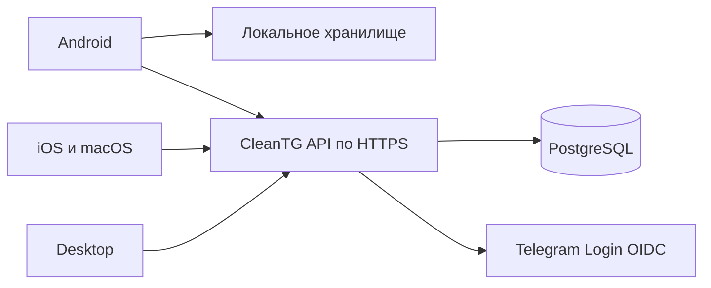

# CleanTG Server Draft

Архитектурный драфт опциональной синхронизации ограничений CleanTG между Android, iOS, Desktop и macOS. Здесь находятся API-контракт, сценарии и задание на реализацию. Работающего сервера, Docker image и клиентского сетевого адаптера пока нет.

Согласованный объём этого этапа — драфт и контракт. Решения ниже являются предложением для проверки в проекте реализации; сроки lease, параметры KDF и детали протокола нужно подтвердить прототипом и security review.

## Основная схема

В настройках каждого Telegram-аккаунта на устройстве появляется **CleanTG → Хранение и синхронизация**:

- **На устройстве** — текущая локальная модель, собственный расход на каждой платформе.
- **На сервере** — HTTPS URL выбранного сервера, подтверждение Telegram-аккаунта, единые правила, PIN и дневной бюджет.

Сервер можно развернуть самостоятельно. В клиентах нет зашитого обязательного адреса CleanTG. Настройки и данные разных серверов изолированы.



Предлагаемый первый backend — один сервис на Go и PostgreSQL за HTTPS reverse proxy. PostgreSQL хранит правила, устройства, PIN verifier, выдаваемые разрешения и учёт времени. Redis, Kafka, отдельный push-сервис и обмен Telegram-сессиями для первого выпуска не требуются.

2026-10-13: пользователь выбрал WebSocket как потенциально рабочую стратегию для real-time обмена. Основной кандидат — REST для входа/настроек и WSS для событий, затем активности и продления разрешений после прототипа. Хранение в «Избранном», CloudStorage Mini Apps и Telegram Serverless не рассматриваем. Go + PostgreSQL остаётся рекомендацией, выбор стека ещё обсуждается. См. [статус WebSocket и границы контракта](docs/realtime.md).

## Ключевые решения

| Область | Предложение для v1 |
| --- | --- |
| Бюджет | Один общий список и суточный бюджет на Telegram-аккаунт |
| Сутки | Фиксированный IANA timezone профиля; границы выдаёт сервер |
| Одновременное чтение | Объединение интервалов действующих разрешений без двойного списания |
| Сеть | Lease до 5 секунд, продление примерно каждые 2 секунды |
| Real-time транспорт | WebSocket — предпочтительный кандидат; формат сообщений и авторизация проверяются прототипом |
| Работа без сети | Просмотр кэша настроек доступен; ограниченный чат закрывается после истечения lease |
| Изменения | Серверная PIN-сессия, revision и атомарная запись |
| Принадлежность аккаунту | Telegram Login OIDC, сверка подтверждённого user ID с текущим аккаунтом клиента |
| Устройства | Отдельный ключ P-256, привязанные к нему токены DPoP, отзыв устройства |
| Доверие | Оператор выбранного сервера доверенный; v1 не обещает E2EE |
| Передаваемые данные | Peer IDs, лимит, timezone и минимальные интервалы активности; без сообщений и Telegram auth keys |

Серверный режим требует доступного сервера для продолжительного чтения выбранных чатов. Автоматического переключения в локальный режим при сбое нет. Переключение режима, URL, отключение синхронизации и восстановление PIN — защищённые операции, а не обходной путь вокруг лимита.

## Документы

- [Архитектура и алгоритм бюджета](docs/architecture.md)
- [Модель угроз и защита](docs/security.md)
- [WebSocket: принятое направление и следующий прототип](docs/realtime.md)
- [Self hosting и эксплуатация](docs/self-hosting.md)
- [План реализации и передача в другой проект](HANDOFF.md)
- [OpenAPI контракт](api/openapi.json)
- [Сценарии приёмки](contracts/sync-scenarios.json)

Перенос в другой проект начинается с `HANDOFF.md`. Этот репозиторий намеренно не содержит `AGENTS.md`: инструкции разработки и базовые промпты должны прийти из подготовленного проекта владельца.

## Проверка контракта

```sh
python -m venv .venv
# Активировать .venv способом своей ОС.
python -m pip install -r requirements-contract.txt
python tools/validate_contract.py
```

Проверка валидирует OpenAPI, внутренние ссылки, схемы примеров и структуру сценариев. Сценарии пока являются спецификацией будущих интеграционных тестов; их наличие не доказывает работу backend или безопасность протокола.

## Границы защиты

CleanTG управляет поведением своих клиентов. Владелец модифицированного клиента или устройства с root/jailbreak может обойти локальную блокировку; официальный Telegram и другие клиенты не ограничиваются этим сервером. Подписанное разрешение подтверждает выданный доступ, но не доказывает, что человек действительно смотрел в экран.

Первый выпуск доверяет оператору сервера, который может видеть выбранные peer IDs и время использования. Названия чатов остаются на клиенте. E2EE потребует отдельного проектирования ключей, подключения устройств и восстановления доступа.

Публичный репозиторий этого этапа содержит только оригинальную спецификацию и искусственные примеры. Лицензию будущего backend-кода необходимо выбрать перед его публикацией.
